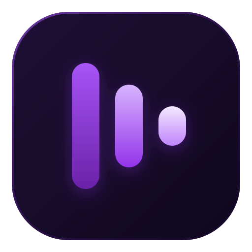
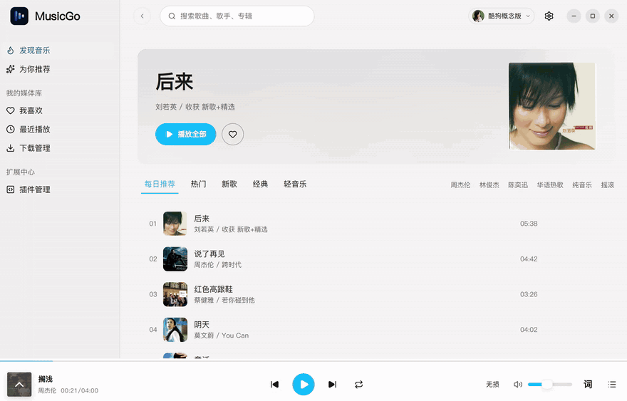

<p align="center">
  
</p>

<h1 align="center">MusicGo</h1>

<p align="center">
  <strong>让音乐，回到桌面。</strong>
</p>

<p align="center">
  Go + <a href="https://github.com/egoist/mygo">MyGo</a> 构建的原生 GPU 音乐播放器<br>
  跨平台桌面体验 · MusicFree 插件生态 · 你的音乐库
</p>

<p align="center">
  <a href="https://github.com/amzkang/MusicGo/releases"></a>
  <a href="go.mod"></a>
  <a href="docs/ARCHITECTURE.md"></a>
  <a href="LICENSE"></a>
</p>

<p align="center">
  <a href="https://github.com/amzkang/MusicGo/releases/latest"><strong>下载最新版</strong></a> ·
  <a href="#交互演示">交互演示</a> ·
  <a href="#功能亮点">功能亮点</a> ·
  <a href="#数据与插件">添加插件</a> ·
  <a href="#从源码构建">源码构建</a> ·
  <a href="docs/README.md">文档中心</a> ·
  <a href="https://github.com/amzkang/MusicGo/issues">问题反馈</a>
</p>

<p align="center">
  <sub>Windows · macOS · Linux &nbsp; / &nbsp; x64 · ARM64</sub>
</p>

---

MusicGo 用 Go 重新构建桌面音乐体验：界面由 MyGo 直接绘制，使用原生 GPU 渲染，无需 Electron、Chromium、WebView 或 Node.js 运行时。以兼容 MusicFree 插件协议与备份数据为目标，把搜索、播放、歌词和音乐库放进同一个桌面应用。

> 项目正在开发中。第三方插件的兼容程度、音源可用性和账号能力取决于具体插件与服务端；当前没有完整的跨平台实机验证结论。

## 交互演示

<p align="center">
  
</p>

<p align="center">
  <sub>点击封面展开歌词 · 左右拖动封面卡片</sub>
</p>

## 功能亮点

<table>
  <tr>
    <td width="50%" valign="top">
      <h3>原生桌面</h3>
      <p>Go + MyGo 原生 GPU 渲染，支持 Windows、macOS 与 Linux，<code>CGO_ENABLED=0</code> 即可构建。</p>
    </td>
    <td width="50%" valign="top">
      <h3>插件生态</h3>
      <p>面向 MusicFree 插件，支持 CommonJS / ESM。跨插件搜索、音源筛选与自动换源，常用宿主依赖由 Go 实现。</p>
    </td>
  </tr>
  <tr>
    <td width="50%" valign="top">
      <h3>听歌体验</h3>
      <p>FFmpeg 优先解码，内置 MP3 / Vorbis 回退。支持下载、音频缓存、均衡器、变速与频谱。</p>
    </td>
    <td width="50%" valign="top">
      <h3>歌词与主题</h3>
      <p>LRC / KRC 歌词、逐字高亮与桌面歌词；浅色、深色及自定义主题，让播放器融入你的桌面。</p>
    </td>
  </tr>
  <tr>
    <td width="50%" valign="top">
      <h3>你的音乐库</h3>
      <p>收藏、歌单、播放历史、队列与会话恢复。纯 Go SQLite 本地存储，支持 MusicFree 备份导入与导出。</p>
    </td>
    <td width="50%" valign="top">
      <h3>系统整合</h3>
      <p>系统托盘、媒体控制与可选全局快捷键，让播放控制随手可及。</p>
    </td>
  </tr>
</table>

完整功能见[功能清单](docs/FEATURES.md)，实现方式见[技术架构](docs/ARCHITECTURE.md)。

## 下载与安装

前往 **[Releases 下载最新版本 →](https://github.com/amzkang/MusicGo/releases/latest)**，按系统与处理器架构选择安装包。

| 系统 | x64 / Intel | ARM64 / Apple Silicon | 安装方式 |
| --- | --- | --- | --- |
| Windows 10 / 11 | `musicgo-setup-版本-amd64.exe` | `musicgo-setup-版本-arm64.exe` | 运行安装程序 |
| macOS 13+ | `musicgo-版本-amd64.dmg` | `musicgo-版本-arm64.dmg` | 打开 DMG，拖入 Applications |
| Linux | `musicgo_版本_amd64.deb` | `musicgo_版本_arm64.deb` | Debian / Ubuntu 使用 `sudo apt install ./下载的文件.deb` |
| 其他 Linux 发行版 | `musicgo-版本-linux-amd64.tar.gz` | `musicgo-版本-linux-arm64.tar.gz` | 解压后运行 `./musicgo` |

推荐安装 **FFmpeg** 并将 `ffmpeg`、`ffprobe` 加入 `PATH`，以支持更多音频格式与时长探测。发布包不包含 FFmpeg，附件提供 `SHA256SUMS` 校验文件。Linux 运行库要求见下方构建说明。

<details>
<summary><strong>安装提示与平台验证状态</strong></summary>

当前 Windows 包未作 Authenticode 签名，macOS 包仅作 ad-hoc 签名、未作 Apple 公证，系统可能显示安全提示。跨平台构建和打包由 GitHub Actions 执行，实机界面、登录和真实播放仍需各平台验证。

</details>

## 数据与插件

**开箱内置**酷狗概念版、QQ 音乐和汽水音乐插件。首次启动会检查已有 MusicFree 插件目录并导入插件，也可以在插件页面管理音源。

**添加自己的插件**：将 MusicFree 插件的 `.js` 文件放入数据目录的 `plugins/`，然后启动程序。

```text
MusicGo/                 数据目录
└── plugins/
    ├── your-plugin.js
    └── another-plugin.js
```

默认数据目录位于系统用户配置目录下的 `MusicGo`，可通过 `MUSICGO_DATA_DIR` 自定义。配置、数据库、账号变量和缓存保存在该目录，请勿提交到仓库；插件会访问对应平台服务，请只加载可信来源的插件。

<details>
<summary><strong>账号登录与音源说明</strong></summary>

- QQ 音乐支持微信扫码，汽水音乐支持汽水 App 扫码；多个账号可在插件管理页选择使用。
- 汽水完整音源受接口限制，仅在上游返回可确认的完整、未加密音源时直接播放，否则尝试自动换源。
- 内置插件源码位于 `internal/plugin/builtin/`，属于构建必需文件。

</details>

## 从源码构建

安装 **Go 1.27.3 或更新版本**，具体版本与依赖以 [go.mod](go.mod) 为准。推荐安装 `ffmpeg` 和 `ffprobe` 并加入 `PATH`，以支持更多音频格式和时长探测。

Linux 原生窗口需要 GTK 3，音频输出使用 PulseAudio（或 PipeWire 提供的兼容服务），不可用时回退到 ALSA；托盘图标还需要 `libayatana-appindicator3`。其他平台及系统运行库要求见 [MyGo v0.7.3 文档](https://github.com/egoist/mygo/blob/v0.7.3/docs/README.md)。

<details open>
<summary><strong>Linux / macOS</strong></summary>

```sh
git clone https://github.com/amzkang/MusicGo.git
cd MusicGo
go mod download
CGO_ENABLED=0 go build -trimpath -tags mygo_noinspector -ldflags "-s -w" -o build/musicgo ./cmd/musicgo
MUSICGO_DATA_DIR=./.data ./build/musicgo
```

</details>

<details>
<summary><strong>Windows PowerShell</strong></summary>

```powershell
git clone https://github.com/amzkang/MusicGo.git
cd MusicGo
go mod download
$env:CGO_ENABLED = "0"
go build -trimpath -tags mygo_noinspector -ldflags "-s -w" -o build/musicgo.exe ./cmd/musicgo
$env:MUSICGO_DATA_DIR = ".\.data"
.\build\musicgo.exe
```

</details>

构建产物统一放在 `build/`。仓库不包含本地 Go 工具链、模块缓存或预编译程序，构建不依赖私人路径或本地 `bin/go` 包装脚本。

<details>
<summary><strong>打包与发布</strong></summary>

[`mygo.json`](mygo.json) 定义原生应用的名称、版本、图标与系统打包配置。使用项目依赖锁定的 MyGo CLI 打包当前系统：

```sh
go run github.com/egoist/mygo/cmd/mygo build
```

通过 `-platform linux/amd64,linux/arm64,windows/amd64,windows/arm64,darwin/amd64,darwin/arm64` 可交叉编译。macOS 签名与 DMG 生成需要在 macOS 执行，Windows 安装程序需要 NSIS（MyGo 在 Windows 上可自动下载）。

更新 `.github/RELEASE_NOTES.md` 和 `mygo.json` 中的版本后推送到 `main`，会触发 [Release 工作流](.github/workflows/release.yml)；也可手动运行工作流或推送与配置版本一致的 `v版本` 标签。六个目标均构建成功后，工作流汇总安装包、生成 SHA-256 校验文件，上传到草稿 Release，再公开发布。已公开版本不会被覆盖。

</details>

## 文档与贡献

| 想了解什么 | 从这里开始 |
| --- | --- |
| 页面、播放、歌词与插件有哪些功能 | [功能清单](docs/FEATURES.md) |
| 原生渲染、插件沙箱与音频链路如何工作 | [技术架构](docs/ARCHITECTURE.md) |
| 播放队列与会话如何管理 | [播放队列](docs/PLAYBACK_QUEUE.md) |
| 参与开发、提交改进 | [贡献说明](CONTRIBUTING.md) |
| 遇到问题、提出想法 | [提交 Issue](https://github.com/amzkang/MusicGo/issues) |

先阅读[贡献说明](CONTRIBUTING.md)。本项目按当前维护约定不提交测试文件，以按改动范围选择的构建和静态检查验证；不运行 `go test`。

<details>
<summary><strong>仓库文件与提交范围</strong></summary>

仓库只保留主程序源码、编译必需资源、依赖清单和维护文档。`.gitignore` 对根目录和文档采用白名单；新增顶层文件、命令或文档时需同步更新规则。正式文档引用的图表与演示动图保存在 `docs/images/`；临时原型、未被文档引用的演示与截图、调研报告及个人文件保留在开发者本地。

</details>

## 致谢与许可

- [MusicFreeDesktop](https://github.com/maotoumao/MusicFreeDesktop) 与 [MusicFree](https://github.com/maotoumao/MusicFree)：项目功能与插件生态的参考。
- [MyGo](https://github.com/egoist/mygo)：原生窗口、GPU 界面与系统能力。
- [mygo-cloudmusic](https://github.com/egoist/mygo-cloudmusic)：会话恢复、缓存和播放过渡等行为设计的参考。
- [Lucide](https://lucide.dev/) 与 [Heroicons](https://heroicons.com/)：界面图标，许可与版权声明见[第三方声明](THIRD_PARTY_NOTICES.md)。
- [goja](https://github.com/dop251/goja)、[esbuild](https://github.com/evanw/esbuild)、[goquery](https://github.com/PuerkitoBio/goquery)、[modernc.org/sqlite](https://pkg.go.dev/modernc.org/sqlite)：插件执行、解析与存储能力；完整依赖见 `go.mod` 和 `go.sum`。

MusicGo 的原创代码（包括 `internal/plugin/builtin/` 中的内置插件）按 [MIT License](LICENSE) 发布。第三方依赖与素材保留各自的许可，详见[第三方声明](THIRD_PARTY_NOTICES.md)。外部安装的插件不受本项目许可证覆盖。

MusicGo 与 MusicFree、酷狗及其他音乐服务的官方团队无隶属关系。项目许可证不授予音乐内容、第三方商标或服务接口的使用权；音乐与封面等内容的权利归相应权利人所有。

---

<p align="center">
  <sub>MusicGo · 让音乐，回到桌面。</sub>
</p>
