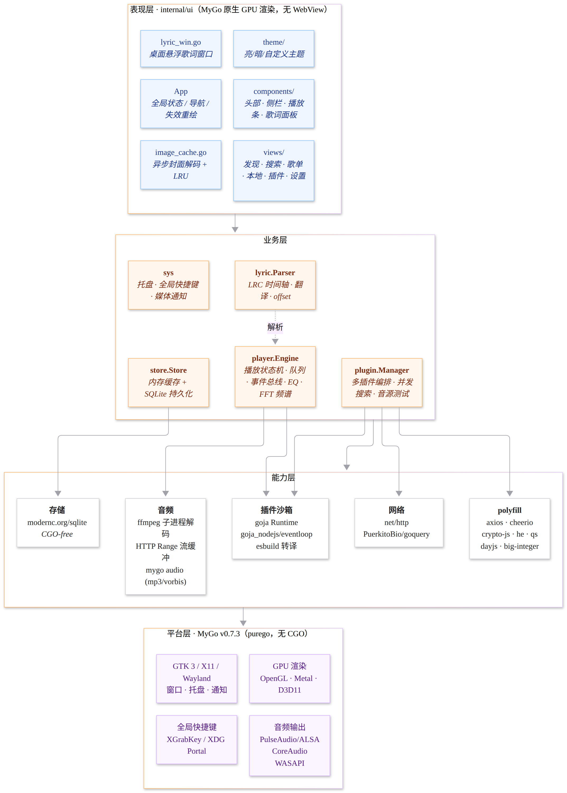
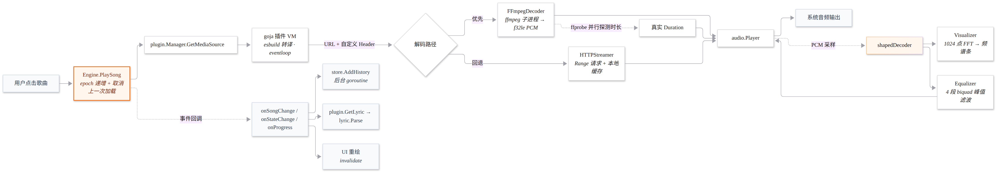
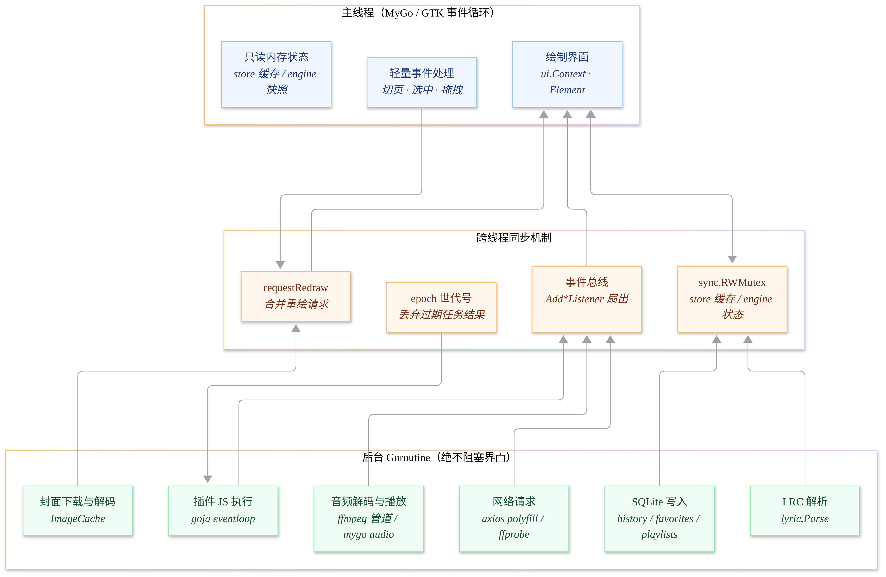
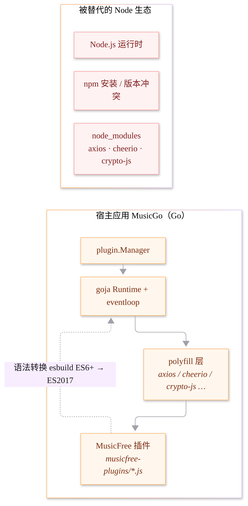

# MusicGo 技术架构

> 目标：把 Electron 版 MusicFreeDesktop 重写为 **Go + MyGo** 的原生 GPU 桌面应用，
> 以兼容现有 MusicFree CommonJS 插件生态与备份数据为目标；具体插件与平台能力需按实际使用验证。



## 目录结构

```
musicgo/
├── cmd/musicgo/main.go        应用入口：装配 store / plugin / player / sys / ui
├── internal/
│   ├── ui/                    表现层（MyGo 原生 GPU 渲染）
│   │   ├── app.go             全局状态、导航、事件总线接入、重绘调度
│   │   ├── image_cache.go     异步封面下载解码 + LRU 淘汰
│   │   ├── lyric_win.go       桌面悬浮歌词窗口
│   │   ├── theme/             亮 / 暗 / 自定义主题
│   │   ├── components/        header · sidebar · playerbar · lyric_panel · spectrum
│   │   ├── views/             recommend · search · playlist · plugins · settings
│   │   └── icons/             内嵌 SVG 图标
│   ├── player/                播放引擎
│   │   ├── engine.go          状态机 · 队列 · 事件总线 · 播放模式
│   │   ├── decoder.go         ffmpeg 子进程 → f32le PCM 解码器
│   │   ├── streamer.go        HTTP Range 流（io.ReadSeekCloser）+ 本地缓存
│   │   ├── eq.go              4 段 biquad 均衡器
│   │   └── visualizer.go      1024 点 radix-2 FFT 频谱
│   ├── plugin/                插件层
│   │   ├── manager.go         多插件编排 · 并发搜索 · 音源测试
│   │   ├── runtime.go         goja 沙箱 · esbuild 转译 · ESM 转换
│   │   ├── esm.go             ESM → CommonJS 转换
│   │   ├── types.go           MusicItem / MediaSource / PluginMeta
│   │   └── polyfill/          axios · cheerio · crypto-js · he · qs · dayjs · big-integer
│   ├── store/                 存储层
│   │   ├── sqlite.go          SQLite + 内存缓存（绘制界面零 IO）
│   │   └── config.go          config.json 读写
│   ├── lyric/parser.go        LRC 解析（时间轴 · 翻译 · offset）
│   └── sys/                   托盘 · 全局快捷键 · 原生系统媒体控制与通知
└── docs/                      本文档与图表
```

## 四层架构

### 1. 表现层 `internal/ui`

用 MyGo 的原生 UI 包直接画，**不使用 WebView、不使用 HTML/CSS、不使用内嵌浏览器**。

- 窗口：`mygo.NewWindow(WindowOptions{Frameless: true, Content: ui.View(app.View)})`
- 渲染：`ui.Column / Row / Box / Text / Icon / Image / Slider / Scroll / Popover / Tabs / List`
- 图标：`//go:embed` 内嵌 SVG，`ui.MustParseSVG`
- 字体：启动时从 `~/.local/share/fonts/pingfang` 注册 PingFang SC
- 重绘：状态和操作变化触发更新；进度条用 `Painter.AnimationFrameRate(30)` 局部重画，时间文字每秒更新，歌词按行和逐字时间调度，不再每 100ms 全局轮询
- 合成：封面与歌词背景使用 `Cache()` 保留 GPU 图层；歌词跟随使用原生 `ScrollState.ScrollTo` 弹簧动画
- 缩放：Ctrl/Cmd + `+`、`-`、`0` 调用 `SetZoom`，范围 80%–150%，`0` 恢复 100%

界面按「视图状态」拆分（`views.RecommendViewState`、`views.SearchViewState` …），
每个状态自带锁，渲染时只读快照。

### 2. 业务层

| 模块 | 职责 |
| --- | --- |
| `player.Engine` | 播放状态机、播放模式、事件总线（`Add*Listener` 扇出）、EQ、频谱；`queue.go` 集中队列条目标识与增删、排序、下一首安排 |
| `plugin.Manager` | 插件加载/卸载、跨插件并发搜索、音源测试与失效判定 |
| `lyric.Parser` | LRC 时间轴、翻译对齐、offset 校正 |
| `store.Store` | 收藏 / 历史 / 歌单的内存缓存 + SQLite 持久化 |
| `sys` | 系统托盘、全局快捷键、原生系统媒体控制、播放通知 |

### 3. 能力层

| 能力 | 选型 | 说明 |
| --- | --- | --- |
| 插件沙箱 | `dop251/goja` + `goja_nodejs/eventloop` + `evanw/esbuild` | 内存内转译 ES6+ → ES2017，运行在 JS 虚拟机里 |
| 宿主依赖 | 手写 Go polyfill | axios → `net/http`；cheerio → `PuerkitoBio/goquery`；crypto-js → 标准库 `crypto` |
| 音频解码 | ffmpeg 子进程 → `f32le` PCM | 优先路径，兼容 mp3/flac/m4a/aac/ogg 等几乎所有格式 |
| 音频回退 | `mygo/audio`（mp3 / vorbis） | 无 ffmpeg 时用内置解码器 |
| 网络流 | `HTTPStreamer`（`io.ReadSeekCloser`） | 支持自定义 Header 与 HTTP Range 拖拽 |
| 存储 | `modernc.org/sqlite` | **纯 Go，无 CGO** |

### 4. 平台层 MyGo v0.7.3（Go 1.27.3）

通过 **purego** 调用系统原生接口，**不使用 cgo**，`CGO_ENABLED=0` 也能编译。

- 窗口/托盘/通知：GTK 3（X11 / Wayland）、Win32、AppKit
- 图形：OpenGL / Metal / D3D11（GPU 合成，UI 由自己绘制）
- 音频输出：PulseAudio（不可用时回退 ALSA）/ CoreAudio / WASAPI
- 音频时钟：`audio.LatencyPlayback` 缓冲策略；进度和歌词读取 `Player.Position()` 的可听位置，歌曲自然结束由 `Player.OnEnd` 驱动
- 系统媒体：统一使用 `mygo.NowPlaying` 接入 Linux MPRIS、macOS Now Playing、Windows 系统媒体控件；元数据和状态按事件发布，系统命令交给后台工作线程执行
- 退出：后台保存与释放资源后调用 `App.Quit()`，由 MyGo 关闭窗口和渲染器
- 全局快捷键：XGrabKey（X11）或 XDG GlobalShortcuts Portal（Wayland）
  - Portal 绑定需要桌面弹出确认窗口，因此**默认不启用**，由用户在设置里开启

## 播放链路



要点：

1. **音源解析**：`plugin.Manager.GetMediaSource` → 插件 JS → URL + 自定义 Header
2. **换源降级**：解析失败时用「曲名 + 歌手」到其它插件再找一次
3. **双解码路径**：优先 ffmpeg（格式最全），失败回退到内置解码器 + HTTP Range 流
4. **真实时长**：`ffprobe` 与解码器**并行**探测，不拖慢起播
5. **PCM 整形**：`shapedDecoder` 在 PCM 上依次过均衡器、喂给 FFT 频谱
6. **事件回流**：切歌 / 状态 / 定位及控制变化通过事件总线扇出，历史入库与歌词解析都在后台完成；连续进度由界面按需读取
7. **自然结束**：`Player.OnEnd` 触发队列前进，播放器身份和世代号校验防止旧回调切换当前歌曲；不再通过定时轮询判断播放结束

## 线程模型



**界面主线程绝不执行阻塞操作**（见[贡献说明](../CONTRIBUTING.md)）：

| 操作 | 所在线程 |
| --- | --- |
| 绘制界面、只读状态快照 | 主线程 |
| 插件 JS 执行 | 后台 goroutine（goja eventloop） |
| 网络请求（axios / ffprobe） | 后台 goroutine |
| 音频解码与播放 | 后台 goroutine（ffmpeg 管道 / mygo audio） |
| SQLite 写入 | 后台 goroutine |
| 封面下载与解码 | 后台 goroutine |
| LRC 解析 | 后台 goroutine |

同步手段：

- `sync.RWMutex`：store 缓存、engine 状态、视图状态
- 事件总线：`Add*Listener` 扇出，多个监听者互不覆盖
- `epoch` 世代号：丢弃过期任务的返回结果
- `requestRedraw`：合并重绘请求；窗口就绪前的请求会被记住，不丢失

## 插件沙箱：替代 Node 生态



MusicFree 插件是 CommonJS（部分是 ESM），依赖 `axios` / `cheerio` / `crypto-js`。
MusicGo **不打包 node_modules**，而是：

| 插件里的写法 | MusicGo 里的实现 | 依赖 |
| --- | --- | --- |
| `require("axios")` | `net/http` + gzip/deflate 解压 + JSON 自动解析 | 标准库 |
| `require("cheerio")` | `PuerkitoBio/goquery` 封装成 `$()` 选择器 | goquery |
| `require("crypto-js")` | MD5 / SHA1 / SHA256 / HmacMD5 / HmacSHA1 / HmacSHA256 / AES-CBC·ECB | 标准库 `crypto` |
| `require("he")` | HTML 实体转义 | 手写 |
| `require("qs")` | 查询串编解码 | 标准库 `net/url` |
| `require("dayjs")` | 日期格式化 | 标准库 `time` |
| `require("big-integer")` | 大整数运算 | 标准库 `math/big` |

插件加载流程：

```
.js 源文件
  → 去除 "use strict"（部分压缩插件有重复声明）
  → esbuild 转译到 ES2017
  → 若是 ESM（export default）→ 转成 CommonJS
  → new Function('require', ..., code) 注入宿主
  → module.exports.default || module.exports
```

## 数据模型

SQLite（`musicgo.db`）：

| 表 | 用途 |
| --- | --- |
| `playlists` | 自建歌单 |
| `playlist_songs` | 歌单内的曲目（含排序） |
| `favorites` | 我喜欢 |
| `history` | 播放历史（保留最近 200 条） |
| `settings` | 预留 |

配置（`config.json`）：主题、音量、播放模式、播放速度、均衡器、桌面歌词参数、
全局快捷键、插件用户变量、自定义主题。

全局快捷键（`enableGlobalShortcuts`）**默认为关**。Wayland 下应用不能自己抓键，
桌面要通过 Portal 绑定，并弹窗让用户确认；每次启动都弹一次很打扰，所以由
用户在「偏好设置 → 快捷键设置」里自己开启。

**内存缓存**：收藏 / 历史 / 歌单在内存中有一份副本，界面绘制只读内存，
写操作先落库再更新缓存 —— 10 fps 的重绘不会产生任何磁盘 IO。

## 兼容性

- **插件**：面向 MusicFree CommonJS 插件，ESM 写法自动转换；宿主 polyfill 不代表完整 Node.js API，兼容性取决于插件使用的能力
- **备份**：导入 / 导出 MusicFree 的 JSON 结构（`sheets` / `favorites` / `history`）
- **插件目录**：启动时自动接管 `~/.config/MusicFree/musicfree-plugins` 等目录下的插件

## 构建与运行

```bash
# 构建（纯 Go，关闭 inspector）
CGO_ENABLED=0 go build -trimpath -tags mygo_noinspector -ldflags "-s -w" -o build/musicgo ./cmd/musicgo

# 运行（可用 MUSICGO_DATA_DIR 指定数据目录）
MUSICGO_DATA_DIR=./.data ./build/musicgo

# 必要时进行静态检查，验证范围遵守 CONTRIBUTING.md
CGO_ENABLED=0 go vet -tags mygo_noinspector ./cmd/musicgo ./internal/...
```

项目当前不维护测试套件，不新增测试文件、测试方法和测试辅助程序，不运行 `go test`。验证约定见[贡献说明](../CONTRIBUTING.md)。


## 播放体验对标增强

- `player.PlaybackSession` 一致快照包含毫秒进度和随机访问记录；应用单一后台工作线程消费合并变更信号及 30 秒检查点，沿用配置原子写入。退出先保存再关闭引擎。
- `player.AudioCache` 管理可再生音频文件与只读用量快照。完整命中优先于插件解析；未命中的顺序下载由 `AudioResource` 写入临时文件，独立游标通过文件前缀或远端 Range 读取，ffmpeg/ffprobe 则通过仅绑定 loopback 的临时 HTTP 资源地址读取。同一响应完整结束、通过长度检查并计算摘要后才纳入缓存，后续命中时复核摘要。
- 缓存预算默认 512 MiB，单首上限四分之一；来源与请求音质隔离，不持久化 URL/Header/Cookie。缓存不可用回退既有链路；设置页读取内存统计，扫描、校验和清理全部后台执行。
- 引擎后台音量包络与世代号协调暂停/恢复和 seek，临时暂停不触发自然结束；共享读游标的取消不影响其他游标或顺序下载。
- 歌词复用后台预模糊图片，最多持有新旧两张背景进行 700ms 淡变；普通行入场由真实播放位置计算，减少动效下直接呈现目标状态。普通 LRC 不生成估算字词时间。
- 搜索框使用当前 MyGo 原生 Combobox；历史在配置中保存且最多 20 条，本地匹配与键盘选择不会调用插件或网络。
