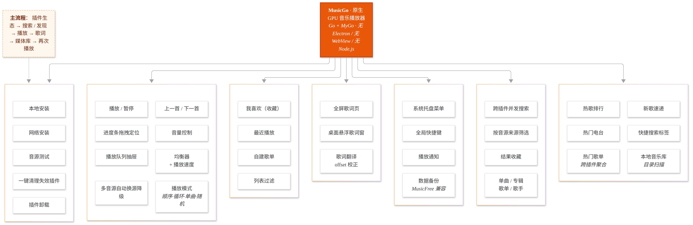
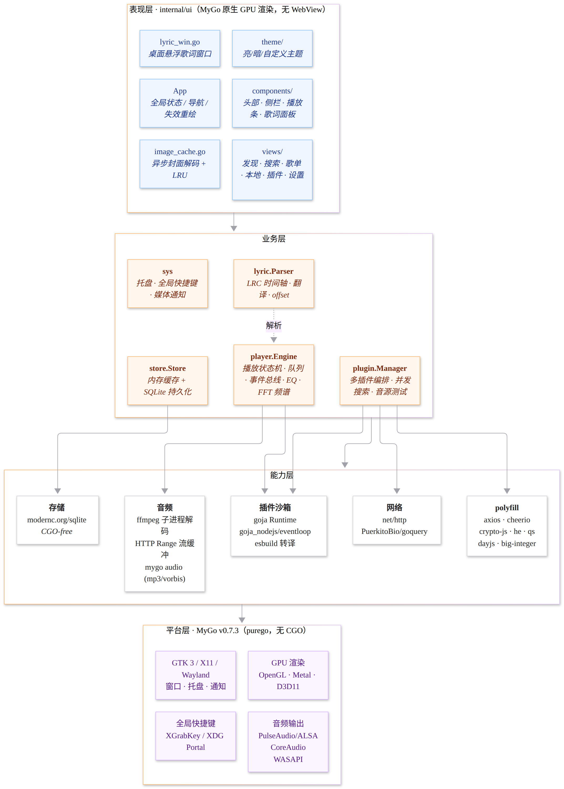
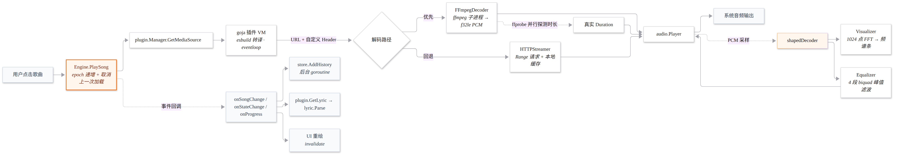
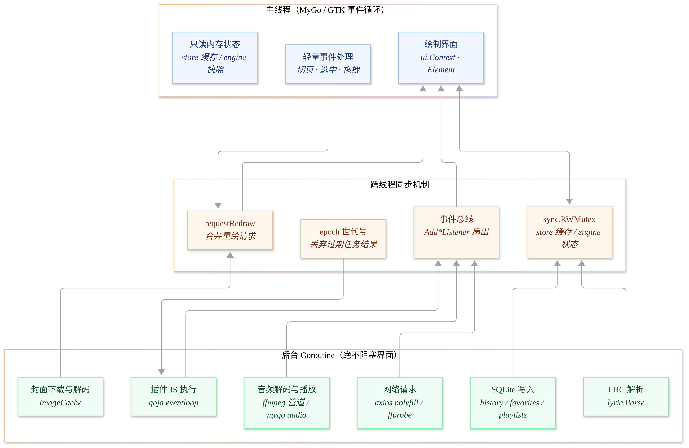
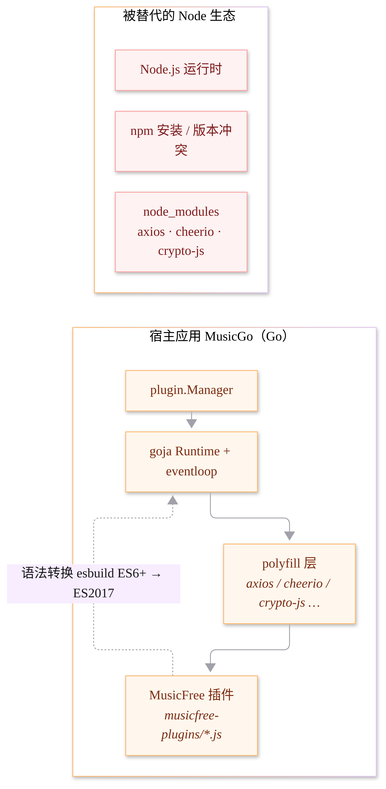

# MusicGo 文档

原生 GPU 音乐播放器 · Go + [MyGo](https://github.com/egoist/mygo) · 无 Electron / 无 WebView / 无 Node.js

| 文档 | 内容 |
| --- | --- |
| [功能图 FEATURES.md](FEATURES.md) | 全功能分区图与逐项说明 |
| [技术架构 ARCHITECTURE.md](ARCHITECTURE.md) | 四层架构、播放链路、线程模型、插件沙箱、数据模型 |
| [播放队列 PLAYBACK_QUEUE.md](PLAYBACK_QUEUE.md) | 队列操作、条目标识与会话兼容 |
| [贡献说明](../CONTRIBUTING.md) | 开发约定、验证方式与提交范围 |

## 图表

| 图 | 说明 |
| --- | --- |
|  | 功能地图 |
|  | 分层技术架构 |
|  | 从点击歌曲到出声的完整链路 |
|  | 主线程 / 后台 goroutine 的职责边界 |
|  | 用 Go polyfill 替代 Node 生态 |

图表源文件在 [`diagrams/`](diagrams/)，用 Mermaid 维护，改完重新渲染即可：

```bash
for f in docs/diagrams/*.mmd; do
  n=$(basename "$f" .mmd)
  npx --yes --package @mermaid-js/mermaid-cli mmdc -i "$f" -o "docs/images/$n.png" -b white -s 2
done
```

Node.js 仅用于可选的文档图表生成，应用构建和运行不需要它。

## 快速开始

```bash
CGO_ENABLED=0 go build -trimpath -tags mygo_noinspector -ldflags "-s -w" -o build/musicgo ./cmd/musicgo
MUSICGO_DATA_DIR=./.data ./build/musicgo
```

数据与插件说明、系统依赖和 Windows 构建命令见[项目首页](../README.md)。
